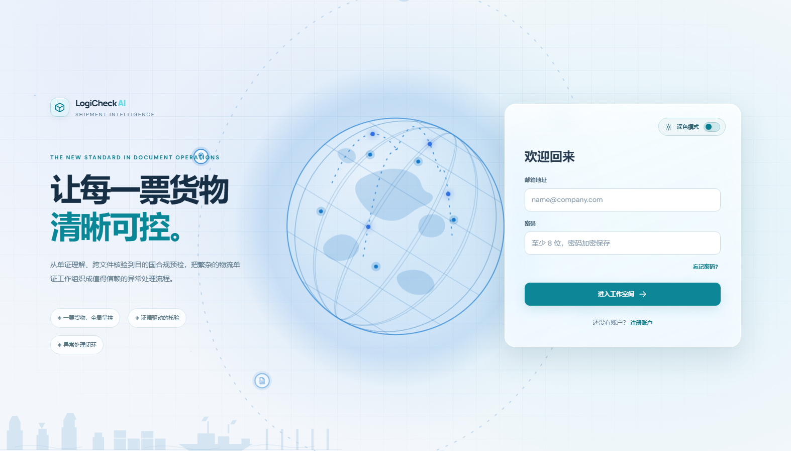
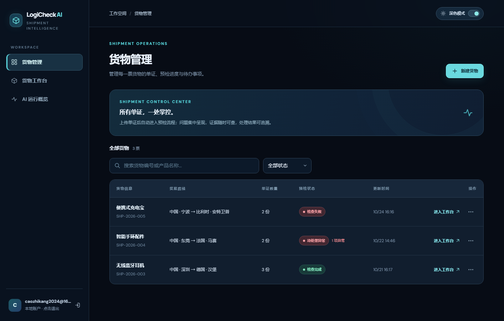
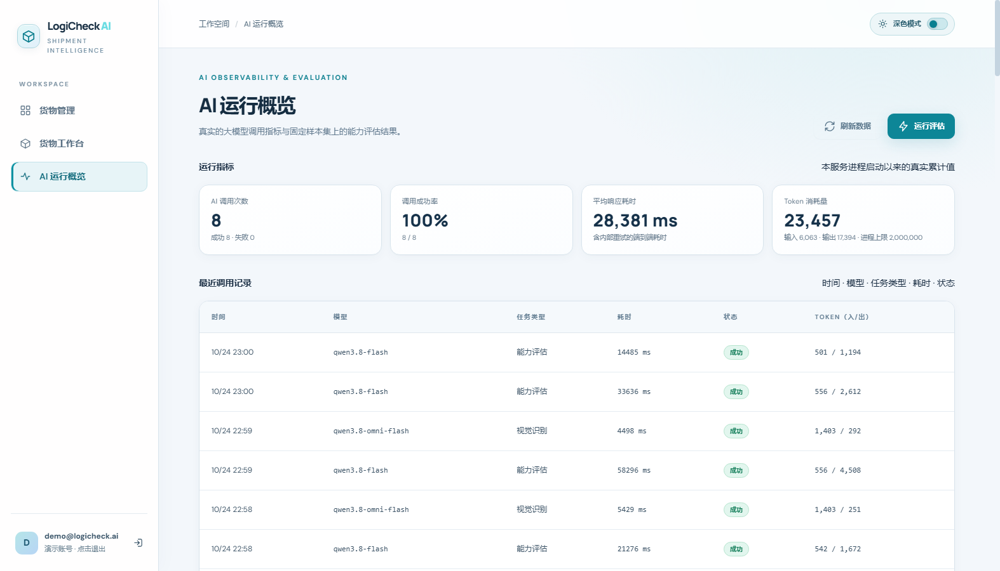
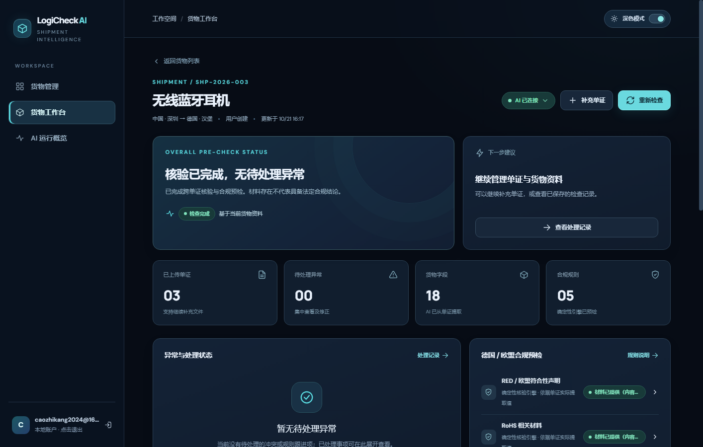
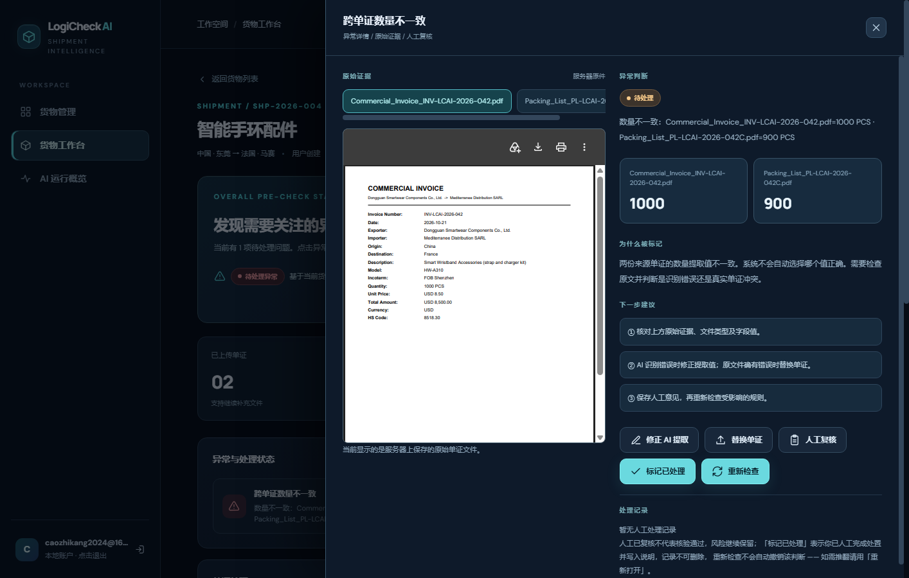
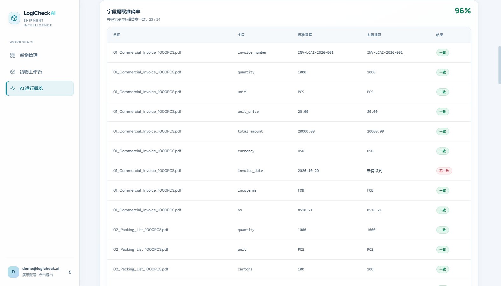

# LogiCheck AI · 跨境货物单证智能预检工作台

> **面向货代单证员的 AI 单证理解与合规预检产品** —— 以「一票货物」为中心，用真实 AI 理解非结构化单证，用可解释的规则引擎核验一致性与目的国材料风险，并帮助用户闭环处理异常。
>
> 本项目为个人作品集（Private），用于展示从**真实业务痛点 → 产品定义 → AI 技术架构 → 可运行落地**的完整能力。

---

## 一、项目简介

跨境物流里，一票货物往往伴随 **发票、装箱单、提单、合规声明、EDI 报文** 等多份单证。传统作业依赖单证员在多个文件之间反复切换、人工比对数量/型号/重量、追查原文、补齐材料——**易错、耗时、难追溯**。

LogiCheck AI 把这套流程产品化：上传单证后，系统自动识别类型、**结构化提取字段**、**跨单证一致性核验**、按目的国（首版：中国→德国）执行**证据驱动的合规预检**，并把所有异常、证据、处理决定沉淀到一个集中工作台，供人工审阅、修正、重检、留痕。

产品设计坚持三条原则（也是我与本项目定下的基线）：

- **AI 不替人决策**：AI 负责「理解 / 提取 / 解释」，确定性规则负责「比较 / 合规预检」，人工对不确定与高风险事项做最终决定。
- **证据链可追溯**：每一个异常都能联动原始单证、页码 / 片段 / 高亮（有坐标时），绝不虚构定位。
- **不伪造结果**：模型失效或密钥缺失时，明确失败并提示原因，而不是编造识别结果。

---

## 二、真实业务痛点（为什么做这个）

| 痛点 | 对单证员的影响 |
| --- | --- |
| 多文件来回切换 | 同一字段（如数量）散落在发票、装箱单、EDI 里，肉眼比对成本高 |
| 字段缺失与单位不统一 | 公/英制、净重/毛重混用，口径不一致导致误判 |
| 数量 / 型号 / 重量冲突 | 单证间数值对不上，需逐项定位原文核实 |
| 材料不全 | 缺电池声明、缺 HS 风险说明，目的国清关受阻 |
| 追查原文耗时 | 出问题后难以快速回到「这句话在原文件哪一页」 |

**产品的收益**：先自动检查，再让人重点处理「高风险 / 低置信度 / 缺失 / 冲突」，而不是替用户武断下结论。

---

## 三、目标用户

- **核心用户**：跨境物流 / 货代公司的单证操作员——每天接收 Invoice、Packing List、B/L、合规材料、EDI 报文。
- **首版场景**：中国 → 德国；便携式蓝牙音箱（内置可充电电池）。这是一个「可控品类 + 单一目的国」的真实切片，便于稳定复现真实单证检查。

---

## 四、核心功能

| 功能 | 说明 |
| --- | --- |
| 🗂️ 货物工作区 | 以「一票货物（Shipment）」为中心组织单证，轻量建货、无需先填完整表单即可上传。 |
| 📄 多格式单证上传 | 真实 PDF（文本层 / 扫描件）、JPG / PNG 图片、EDIFACT（首版子集）均可上传，带进度与失败重试。 |
| 🤖 AI 字段提取 | 真实大模型理解非结构化文件，输出结构化字段 + 来源 + 置信度 / 待复核标记；图片与扫描件走视觉 OCR。 |
| 🔗 跨单证一致性核验 | 数量、单位、重量、箱数、型号、目的地、HS 等跨单证比对，冲突值**不被静默覆盖**，保留多候选来源。 |
| 🛡️ 合规预检规则引擎 | 版本化德国 / 欧盟规则集（材料完整性、适用范围、HS 潜在风险），每条结果附 `ruleId / 来源 / 适用条件 / 版本 / 证据 / 建议`。 |
| 🔍 证据链联动 | 点击异常即联动原文件预览，定位页码 / 片段 / 高亮（有坐标时），支持双方对照。 |
| 🧩 异常闭环 | 区分「AI 提取错」与「真实单证冲突」，支持修正字段、替换单证、人工处理决定、再检查，全程留痕。 |
| 👁️ 原件预览 | 图片 / PDF / EDI 原文预览，失败单证展示真实失败原因与处理建议。 |

### 界面展示（来自真实运行截图）

<p float="left">
  
  
</p>

<p float="left">
  
  
</p>

<p float="left">
  
  
</p>

---

## 五、产品流程

**核心路径**

```
注册 / 登录
  → 创建轻量货物工作区
  → 上传 1~N 份单证（允许只传一份先启动）
  → 系统自动识别类型并提取字段（确定性 / AI 双引擎）
  → 生成统一货物信息（保留来源与冲突候选值）
  → 自动运行跨单证核验 + 适用规则预检
  → 工作台展示检查结果
  → 用户审阅异常 / 修正提取值 / 替换或补充文件 / 记录人工决定
  → 再检查（产生新的 Run，附时间与规则 / 模型版本）
  → 形成最新结论并保留历史
```

**关键设计决策（节选自 PRD 14 项基线）**

- 不上传齐全也能核验：能比的先比，缺证据的明确标记「证据不足」，绝不误写「通过」。
- AI 不从冲突文件里偷偷选一个当权威真值；冲突以「待定 + 多候选来源」呈现。
- 「人工确认」≠「问题已解决」：有原始冲突而未换单时，只能记录「接受风险 / 已知问题」，不可假装冲突消失。
- 每次补件 / 修正都产生新的检查 Run，附时间戳与规则 / 模型版本，便于追溯。

**最小状态机（节选）**

| 对象 | 状态集合 |
| --- | --- |
| Shipment | draft / processing / needs_review / checked / failed（`checked` 仅表示本轮检查完成，不等同全部合规） |
| Document | uploading / uploaded / parsing / parsed / failed / replaced |
| Finding | open / reviewing / resolved / accepted_risk / not_applicable |
| Check Item | passed / issue / warning / insufficient_evidence / not_applicable / error |

---

## 六、AI 技术架构

```
┌─────────────────────────── 前端 (React 18 + TS + Vite) ───────────────────────────┐
│  登录 / 货物列表 / 工作台 / 异常抽屉 / 合规规则 / AI 概览                          │
│  实时阶段/进度/错误反馈 · 双主题 · 响应式 · 无死按钮                              │
└───────────────▲───────────────────────────┬──────────────────────────────────────┘
                │  /api (同源 Cookie 会话)    │
┌───────────────┴───────────────────────────▼──────────────────────────────────────┐
│  后端 (Fastify 5 + node:sqlite)                                                   │
│  ├─ 认证与多租户隔离：注册/登录/会话/退出，用户数据严格隔离                       │
│  ├─ 单证流水线：上传 → 类型识别 → 解析（PDF/图片/EDI）→ 结构化字段 Schema          │
│  ├─ 提取 Provider 接口                                                          │
│  │    ├─ 确定性提取（默认，纯规则，零外部调用）                                  │
│  │    └─ AI 提取（阿里云百炼 DashScope，OpenAI 兼容协议）                        │
│  │         ├─ 文本/图片 → 大模型结构化提取 + 原文引用核验                         │
│  │         └─ 扫描件 PDF → 光栅化 → 视觉 OCR（无可靠坐标则不画虚假高亮）          │
│  ├─ 跨单证核验引擎：数值先标准化（单位换算）再比对，语义差异可解释                │
│  ├─ 合规预检规则引擎：版本化德国/EU 规则集，结果附带证据与建议                   │
│  ├─ 异常处理闭环：修正/替换/人工决定/再检查，保留历史 Run                        │
│  └─ 可观测性与护栏：调用统计、单账号每日 AI 配额、上传/接口频率限制              │
└──────────────────────────────────────────────────────────────────────────────────┘
```

**架构亮点（产品 + 工程双视角）**

- **双引擎可降级**：`EXTRACTION_PROVIDER=auto` 时，检测到密钥自动启用真实大模型，无密钥自动降级为确定性提取——**服务永远能跑，AI 缺失时明确提示而非伪造**。这是面向「公网部署防烧钱 / 防假结果」的关键设计。
- **原文引用核验**：AI 提取的每个字段都带回来源文档、页码 / 片段，前端可联动定位，把「黑盒输出」变成「可审计证据」。
- **规则与 AI 职责分离**：AI 做理解与提取，确定性规则做比较与合规预检——既发挥模型能力，又保证比较结果稳定可复现、可解释。
- **前后端同端口**：Fastify 直接托管前端构建产物，单一 HTTP 服务即可发布，降低部署复杂度。
- **防滥用护栏**：单账号每日 AI 解析上限、上传大小/频率限制、全局 API 频率限制，避免公网访问导致额度失控。

---

## 七、测试结果

| 测试层 | 范围 | 结果 |
| --- | --- | --- |
| 后端单元 / 集成测试 | 认证与隔离、货物 CRUD、单证上传解析、AI 提取（含失败分类）、跨单证核验、合规预检、防滥用配额、数据库迁移 | **239 / 239 通过** |
| 前端 E2E（CDP 无头浏览器，真实链路） | 登录 / 双主题 / 列表 / 工作台 / 异常抽屉 / 证据链 / 字段修正 / 重检 / 人工复核 / 规则抽屉 / 真实文件上传预览 / 上传拒绝 / 删除 / 刷新重登恢复 / 响应式 / JS 异常监控 | **91 / 91 通过** |
| 全量回归 | 本地构建 + 后端测试 + 三模式（Mock / RealApi / 确定性）E2E | 全绿 |

> 验证理念：自动化测试 + 真实文件集 E2E + 产品 Owner 人工验收；不允许失效按钮、Mock 伪装、数据丢失或跨账号泄露（对齐 PRD QA-01）。

---

## 八、本地运行方法

### 前置要求

- **Node.js ≥ 22.5**（后端使用 Node 内置 `node:sqlite`，需 22.5+）
- npm（随 Node 自带）

### 1. 启动后端（默认端口 4000）

```bash
cd logicheck-ai-server
cp .env.example .env          # 复制配置模板
npm install
npm run dev                   # 开发模式（热重载）
# 生产模式：npm run build && npm start
```

> **关于 AI 能力**：`.env` 中留空 `DASHSCOPE_API_KEY` / `AI_MODEL` 时，系统自动使用**确定性提取**（零外部调用，可完整演示核验流程）；填入阿里云百炼 DashScope 的 Key 与模型名后，自动切换为**真实大模型提取**。密钥只写在 `.env` 里，`.env` 已被 `.gitignore` 忽略，不会进入仓库。

### 2. 启动前端（默认端口 5173）

```bash
cd logicheck-ai-web
npm install
npm run dev                   # Vite 开发服务器，已配置 /api 代理到后端 4000
```

浏览器打开 `http://localhost:5173` 即可使用。

### 3. 演示账号

首次启动会自动种子一个演示账号与一票演示货物（含 4 份单证），可直接登录体验：

- 账号：`demo@logicheck.ai`
- 密码：`demo1234`（可通过 `DEMO_PASSWORD` 环境变量修改）

### 4. 运行测试

```bash
# 后端测试
cd logicheck-ai-server && npm test

# 前端 E2E（确定性模式，自建独立栈，无需真实 Key）
cd logicheck-ai-web && node e2e/run-tests.mjs
```

### 5. 单端口发布（可选）

`logicheck-ai-server/` 下的 `npm run bundle` 会生成 `deploy-bundle/`（前端产物 + 服务端源码 + 评估夹具，**密钥绝不进包**），可直接作为单端口 HTTP 服务发布。详见 `logicheck-ai-server/deploy-bundle/README-DEPLOY.md`。

> 注：`deploy-bundle/` 为构建产物，已被 `.gitignore` 排除，不进入本仓库。

---

## 九、作品集展示

- **产品截图**：见上方「核心功能」一节（`screenshots/` 目录），覆盖登录、列表、AI 概览、工作台、异常抽屉、AI 评估等真实界面。
- **Demo 视频**：


> 视频文件较大（约 42 MB），建议在仓库页面直接播放；如无法内联播放，可下载后本地观看。

---

## 十、安全与密钥管理

本项目从设计上把安全放在首位：

- **密钥零入库**：`.env`、`.env.*` 全部被 `.gitignore` 忽略；仓库只保留 `.env.example` 模板（无真实值）。
- **运行时数据不入库**：SQLite 数据库（`*.db`）、用户上传文件（`data/`）、本地邮件发件箱、构建产物（`dist/`、`node_modules/`）、发布 staging（`deploy-bundle/`）均不进入 Git。
- **提交前已做敏感扫描**：确认 Git 历史与当前工作区均未包含真实密钥、数据库或账号密码；仅存在文档中的占位符（如 `sk-...`）与测试用假 Key。

---

## 十一、项目结构

```
.
├── logicheck-ai-server/        # 后端：Fastify 5 + node:sqlite
│   ├── src/
│   │   ├── core/               # 错误/限流/AI 配额/Node 版本守卫
│   │   ├── db/                 # SQLite schema 与迁移
│   │   ├── modules/
│   │   │   ├── auth/           # 注册/登录/会话/多租户隔离
│   │   │   ├── documents/      # 上传/私有存储/预览
│   │   │   ├── parsing/        # PDF/图片/EDI 解析 + AI/确定性 Provider
│   │   │   ├── checking/       # 跨单证核验引擎
│   │   │   ├── compliance/     # 合规预检规则引擎
│   │   │   ├── demo/           # 演示账号/货物种子
│   │   │   └── system/         # AI 评估/可观测接口
│   │   ├── app.ts              # 应用装配（含静态托管 + 频率限制）
│   │   ├── config.ts           # 环境变量配置（含安全边界）
│   │   └── index.ts            # 入口
│   ├── test/                   # 后端测试（239 项）
│   └── .env.example            # 配置模板（无真实密钥）
├── logicheck-ai-web/           # 前端：React 18 + TS + Vite 6
│   ├── src/                    # 页面 / 组件 / API Contract / 状态管理
│   └── e2e/                    # CDP 无头浏览器端到端测试（91 项）
├── screenshots/               # 作品集展示截图
├── demo视频.mp4                # 作品集 Demo 视频
├── 01_*.pdf … 07_*.pdf / 06_*.edi / ground_truth.json  # 评估夹具（真实单证样例）
├── PRD-v2.md                  # 产品需求文档（14 项核心决策）
└── README.md                  # 本文档
```

---

## 十二、技术栈

| 层 | 技术 |
| --- | --- |
| 前端 | React 18、TypeScript、Vite 6、Tailwind CSS v4、React Router 6 |
| 后端 | Fastify 5、Node.js（内置 `node:sqlite`）、Zod 校验 |
| AI | 阿里云百炼 DashScope（OpenAI 兼容协议），文本提取 + 视觉 OCR；确定性提取作降级 |
| 存储 | SQLite（零外部依赖）+ 本地私有文件存储 |
| 测试 | Node 内置 Test Runner、CDP 无头浏览器 E2E |

---

## 十三、许可证与免责声明

- 本项目为个人学习 / 作品集用途。
- 合规预检规则为**演示性**的德国 / 欧盟材料风险参考，**不构成法律意见**，真实清关请以官方要求与专业意见为准。
- 演示数据均为样例，不含任何真实个人隐私或商业机密。
